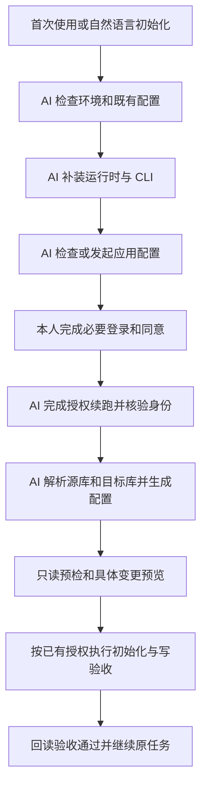

# 首次使用前提盘点与 AI 自动初始化迭代方案

日期：2026-10-26

对象：从 GitHub 插件市场安装 `general-screenwriter` 的新电脑、新使用者

状态：设计提案；本次未修改运行逻辑、安装依赖或操作真实飞书资源

## 1. 目标与已确认要求

同事安装插件后，直接用自然语言开始使用。AI 负责环境探测、补装依赖、飞书 CLI 应用配置、授权发起与续跑、知识库配置生成、初始化和验收。每位同事都需要读取原始库并同步写入目标知识库，这一点已由用户在本次对话中确认。

用户已明确的要求：

- lark-cli 使用最低版本要求，不限制为某几个具体版本；高于最低版本的版本均通过版本检查。
- 用户不打开终端、不复制执行命令、不填写 token/space_id、不手工编辑 JSON、不为刷新 PATH 重开终端。
- 计算机和浏览器操作中，AI 能完成的部分由 AI 完成。
- 账号登录、扫码、授权同意及管理员审批等必须由本人作出的动作保留给本人；AI 负责打开页面、填写普通配置、解释并接续后续流程。

本提案采用的工程原则：复用同事已有的合格运行时、CLI、应用配置和有效授权；不强制重装或每台电脑重新创建应用。原始库沿用现有只读边界。首次配置和共享结构初始化完成，不代表用户已经请求执行一次全量知识同步。

成功标准是“每位同事实际具备源库读取和目标库写入能力”，而不只是安装器退出成功或浏览器显示授权完成。

## 2. 现状与证据

以下均为本次工作区代码审阅结果。相对路径以仓库根为起点。

| 现状 | 证据 | 对新使用者的影响 |
| --- | --- | --- |
| 精确版本白名单，只有 1.0.95/1.0.96 被接受 | `plugins/general-screenwriter/skills/feishu-knowledge-store/scripts/lark_cli_bootstrap.py:17,173`；`lark_cli.py:203-210` | 正常的新版本也会被拒绝；规则重复维护 |
| 安装器使用 `npx @larksuite/cli@latest install`，已有“不支持版本”则直接返回 | `lark_cli_bootstrap.py:18,40-64` | 可能装到一个被自己拒绝的版本；旧版本无法自动修复 |
| 缺 npx 时提示用户安装 Node；安装后找不到 CLI 时要求重开终端 | `lark_cli_bootstrap.py:61-64,87-91` | 自动化止于依赖缺失与 PATH 刷新 |
| README 和三个飞书技能要求用户自己执行登录 | `README.md:79-86`；`feishu-knowledge-store/SKILL.md:26-27`；`knowledge-loader/SKILL.md:14`；`wiki-ingest/SKILL.md:29-32`；`wiki-ingest/references/feishu-wiki-extraction.md:45` | 不符合用户无需命令行的要求 |
| 没有应用初始化、授权发起、设备码续跑的实现 | `lark_cli.py:70-77` 只有授权状态检查；全仓登录命中主要是说明文字 | 新电脑缺少 CLI 应用配置时没有完整路径 |
| 需要手工复制模板并填写知识库配置 | `README.md:88-100`；`config/feishu-knowledge-base.example.json` | 普通使用者需要理解内部 ID 与 root_mode |
| CLI 探测与执行路径不一致 | bootstrap 检查标准位置；`config.py:104-113` 只取环境变量和 PATH；`store_cli.py:33` 直接取第一个候选；`authority_cli.py:74` 传入可能为空的候选 | 会出现探测成功但后续仍找不到 CLI，或执行了未经验证的候选 |
| preflight 只查询授权状态和目标节点；space 模式连目标节点也不读 | `lark_cli.py:70-77` | 未验证源库可读，也未证明目标可写 |
| preflight 前必须先解析已存在的完整控制树 | `store_cli.py:30-44`；`publisher.py:81-108` | 空目标库尚未初始化时，身份诊断都可能被提前阻断 |
| 有 Publisher.initialize，但公开 store CLI 没有独立 init 命令 | `publisher.py:53-79`；`store_cli.py:47-70` | 首次建共享结构的入口不完整 |
| 市场声明 ON_INSTALL，但插件仅提供 skills，没有实际首次使用编排实现 | `.agents/plugins/marketplace.json`；`.codex-plugin/plugin.json`；`config/plugin-contract.json` | 不能把市场元数据视为已完成飞书安装与认证 |
| 已有跨平台配置发现与旧路径兼容 | `config_paths.py:37-78,93-120` | 可以复用，不需要重造知识库配置体系 |
| 发布检查没有覆盖完整新用户向导 | `docs/RELEASE.md:28-35` | 现有离线通过不能证明其他同事的新电脑能走通 |

当前插件包版本为 0.7.0。本次审阅时工作区原有文件无未提交修改。

## 3. 首次使用前提与责任

| 前提 | AI 要做的事 | 用户或管理员保留的动作 |
| --- | --- | --- |
| 插件已从 GitHub 市场安装且技能可发现 | 定位本次实际安装目录；执行包内脚本，避免假设存在源码 checkout | 在市场添加仓库并安装插件 |
| 宿主允许 AI 执行本地工具、写入用户配置、必要的网络访问 | 使用现有权限执行；遇到真实策略拦截时说明影响并申请相应权限 | 处理宿主或企业策略确实要求的批准 |
| 可用 Python 3.10+ | 先探测可复用的宿主配套运行时与系统解释器；排除 Store 占位程序；缺失时由 AI 补装用户级运行时 | 仅处理系统确实要求的授权 |
| CLI 安装需要时有可用 Node/npm/npx | 检测实际可执行能力；缺失时由 AI 安装用户级运行时；使用绝对路径执行 | 无命令行操作 |
| 合格 lark-cli | 复用或安装；比较最低版本；检查所需命令；把已验证路径传给全部消费者 | 无命令行操作 |
| 已配置飞书 CLI 应用 | 只读检查当前 CLI profile；已有合格应用就复用；缺失时发起官方创建流程并协助页面操作 | 完成本人账号登录、应用创建确认；无开发者权限时由管理员批准 |
| 当前使用者的 user 授权 | 发起指定权限的设备授权、展示链接与二维码、续跑设备码并重新核验身份 | 登录、扫码和同意授权 |
| 应用权限、用户授权、资源访问权限三层均满足 | 列出并诊断缺失项；能自动补齐的普通配置由 AI 处理 | 管理员批准应用权限，或资源所有者授予源库读取/目标库写入权限 |
| 能定位源库和目标库 | 复用有效配置；否则询问两个链接并通过 API 解析空间和节点；默认不改动已有非空配置 | 配置未知时提供库链接；有歧义时选择正确资源 |
| 目标共享控制结构可用 | 正常情况只复用和检查；空库走一次性初始化；冲突时清楚说明 | 仅首次新增共享结构或替换既有配置时审阅具体变更 |
| 能实际读源库、写目标库 | 执行分层验收，区分只读预检与实际写验证；回读结果 | 对验收页写入作出必要的具体授权，可与首次初始化确认合并 |

Python 是当前创作、飞书适配和校验脚本的实际运行依赖；Node 是 npm 安装路线的依赖，不能要求已经有可用 CLI 的用户仅为了版本检查再安装 Node。AI 优先使用当前宿主提供且可执行的运行时；不能将作者机器或某次缓存的绝对路径写进插件。

插画 API 密钥、图片生成费用确认、可选图像压缩的 Pillow、导出目录和多 Agent 能力属于按需前提，不应阻挡首次飞书配置。仓库不需要同事安装 Git、克隆源码或安装完整开发测试环境；市场安装动作本身所需的底层组件由宿主管理。

## 4. 方案比较与推荐

| 路线 | 能解决什么 | 代价与限制 |
| --- | --- | --- |
| 仅修版本与文档 | 最快消除新版本误拒绝 | 应用创建、授权续跑、运行时自举、空库初始化仍未串联，无法达到目标 |
| 依赖另装的 lark 技能负责初始化 | 可复用已有飞书操作规范 | 同事必须额外安装并保持匹配，市场安装本插件仍不自足 |
| 本插件内置 setup/doctor，复用官方 CLI 与现有适配器（推荐） | 从自然语言进入完整自举和验收；可恢复、可测试 | 需要新增状态机、运行时引导和授权适配 |

本提案采用第三条作为推荐路线，尚未视为用户对具体实现细节的批准。通用飞书规则可参考官方技能，但初始化必须自包含在插件包中，不能依赖作者电脑已有的全局 `lark-shared` 或另一插件。

不把多平台 CLI 二进制直接塞进插件包；通过官方安装链路按需获取。正式发布须验证所选安装方式不会改变用户已有的其他插件或无关 CLI 配置。

## 5. 新的用户流程

用户安装后可直接说“帮我初始化编剧插件”，也可直接发起创作或知识同步。涉及飞书的主入口先检查准备状态，缺什么补什么；完成后继续原任务，不让用户重新描述。

正常路径中不出现要求用户运行的代码块。只有确实缺信息时才询问；同一轮不重复索要已经提供的库链接、账号选择或批准。

应用创建和 OAuth 授权由 AI 发起。页面中的普通填写、跳转与复制由可用浏览器工具执行；如果没有浏览器控制工具，提供原始链接及二维码，由用户完成必须在该页面进行的动作。不会要求用户自己生成授权链接或执行续跑命令。

## 6. 最低版本与 CLI 兼容策略

### 6.1 单一规则

初始最低版本提议为 **1.0.95**。现有代码已以该版本为兼容基线；官方 v1.0.95 tag 亦包含 `config init --new`、split-flow 授权、profile 选择与 JSON 信封说明。上线前仍须实际执行该最低版本的关键兼容验收；源码存在不等于已做完整实测。

- 一处定义 `MIN_LARK_CLI_VERSION = 1.0.95`；删除所有精确版本白名单和重复版本判断。
- 使用数值语义版本比较；例如 1.0.100、1.1.0、2.0.0 均通过版本门槛；不加上限、不按 tested 列表筛选。
- `tested_versions` 仅记录兼容验收结果，绝不参与准入条件。
- 低于最低版本：AI 在用户级独立位置安装满足要求的稳定版本，并让本插件使用它；不覆盖系统旧版本。
- 已有合格版本：直接复用，不因出现更新提示而升级，不降级高版本。
- 无法识别版本、程序不可执行、能力不满足分别给出准确状态；不再统称 unsupported。

### 6.2 版本通过后的能力检查

检查实际需要的命令与参数：应用配置、授权发起/续跑、状态核验、profile 选择、Wiki 读取/创建、文档读取/带 revision 更新等。AI 通过 help/schema 与无写入探针确认用法。

能力或输出契约不匹配时报告具体命令和缺失能力；这属于运行兼容问题，不是“该版本没进白名单”。不根据未知输出继续写入，也不因此自动降级到旧版。

现有文档适配器使用绝对路径临时内容文件，须一并按实际 CLI 文件访问规则验证。目标版本要求 cwd 内相对路径时，由 AI 设置正确工作目录并生成相对路径输入；命令支持 stdin 时可优先使用。不能把安全路径错误交给用户修参数。

所有调用显式选择其支持的输出格式，并通过一个适配层按命令协议归一化。普通 API 调用按 CLI 官方信封识别 `ok/data/error`、退出状态与 stderr；设备授权发起等命令单独解析。v1.0.95 的 `auth login --no-wait --json` 返回裸对象，必需字段为 verification_url、device_code、expires_in，不能要求它带 `ok/data`，也不能要求存在 user_code。兼容现有业务使用的数据结构，不把所有退出码 0 都等同于 user 已就绪。授权状态必须检查实际用户状态与 verified 结果。`_notice` 不影响业务结果，也不触发无关升级。

### 6.3 路径与 profile

新建一个统一解析器，返回经过真实探测的 `CliContext`：绝对可执行路径、实际版本、profile、命令执行环境、能力报告。bootstrap、store_cli、authority_cli 和 wiki-ingest 使用同一个结果；不再自行取 `cli_candidates[0]`。

兼容现有 `LARK_CLI_PATH`、PATH、标准安装目录，并加入本插件的用户级私有安装位置。显式路径有问题时报告问题及修复结果；不让后续再次命中同一个失效值。安装后直接使用已确认的绝对路径，当前会话无需刷新全局 PATH。

已有有效 profile 则复用并在每次调用中显式绑定；多个候选或账号冲突时只询问必要的账号选择。不会悄悄切换、删除其他 profile，也不把 bot 可用当作 user 登录完成。

## 7. 自举与授权编排

### 7.1 不依赖 Python 已安装的启动入口

提供包内 Windows 与 POSIX 薄启动器，供 AI 内部调用。启动器先寻找合格解释器；宿主提供配套运行时且允许使用时优先复用，其次系统已装运行时，最后按平台安装用户级私有运行时。真实下载按官方发布信息与校验值验证，落在用户数据目录，失败清楚区分网络、权限、架构与校验问题。

当前 Windows 是首个完整验收平台。macOS/Linux 的启动器、安装包与执行路径同步支持；未经实际验收的平台/架构在报告中明确标注，不宣传已经通过。具体运行时发布版本是内部安装清单的维护项，业务准入仍按最低能力判断。

Node 只在需要 npm 安装 CLI 或其他相应功能时补装。官方 `npx @larksuite/cli@latest install` 是可用安装路线；私有安装须先验证官方安装器的 prefix/目录选项，不能凭经验拼参数。若安装器不能满足独立目录要求，选择官方支持的包/二进制安装方式并验证产物。宿主不允许安装时报告真实阻碍，不能把命令转交用户代跑。

### 7.2 应用配置

AI 先检查当前应用是否配置，只读取完成判断所需的掩码摘要，不将 `config show` 的完整输出写日志或发进对话。

没有应用时，AI 说明将创建的应用用途及权限，并发起官方 `config init --new` 流程。已有明确初始化授权则沿用；CLI 自己返回新的风险确认或企业审批要求时再处理对应确认。`--force` 等参数不能被当作通用自动化开关。

应用配置输出的授权/控制台链接同样原样保留，生成二维码并确保用户可见；后台进程的等待与完成检查由 AI 管理。

不要让用户复制 appId/appSecret 到聊天。凭证继续由 CLI 管理；插件知识库配置、状态报告、Git 与导出物均不保存密钥。

### 7.3 设备授权

AI 确定本插件所需 scope 后发起非阻塞设备授权。授权范围同时覆盖源库读取与目标库同步写入，但不使用 `domain all` 申请无关业务权限。

1. 使用 CLI 确认支持的 split-flow 发起参数，获取 verification URL、device_code 和过期时间；user_code 仅在该版本实际返回时作为可选展示字段。
2. 原样保留 URL，不重拼 query；生成 PNG 二维码并在用户可见消息中同时展示链接和二维码。
3. 必须确保链接已对用户可见后才等待；宿主不透传中间输出时结束当前轮，待用户完成后再续跑。
4. 用户完成必要同意后，AI 用 **device_code** 续跑；user_code 是给用户看的短码，不能代替 device_code。
5. 重新核验 user 身份、token 有效性、必要 scope、实际库访问权限。

授权过期则重新发起同一权限范围的新请求；不复用失效链接。device_code 只在本次授权会话的内存或受限临时存储保存，带 TTL，不进入普通日志、长期配置和通用状态快照。重新打开聊天时先验证当前真实状态，再决定续跑或重新发起。

### 7.4 权限清单

新增可维护的权限清单，将实际使用的 CLI/API 映射到必要 scope：Wiki 空间/节点读取与创建、文档读取与更新及 revision、原始资料附件读取、目标验收与同步所需操作。具体 scope 字符串必须从所选最低版本及官方 API 契约核实，不凭名称推测。

应用已开通的 scope、用户已授权的 scope、用户对具体资源的读写权限分别显示和判断。管理员审批未完成时进入 `waiting_admin`，AI 保存非敏感进度并在批准后继续。AI 不替管理员授予自己没有权限管理的资源。

## 8. 配置生成、共享初始化与验收

### 8.1 配置生成与迁移

沿用知识库 schema v2 与已有配置发现顺序，不为工具路径混入新知识字段。团队共用源/目标库定位信息，个人 CLI 路径、profile、登录状态与凭证保持个人隔离。

默认先复用有效配置。没有配置时，由用户提供源/目标链接，AI 通过 API 解析空间 ID 和根节点，检查 root_mode 并生成配置。库身份不明确时不猜；不把作者电脑配置当团队默认值。

新配置默认写已有跨平台用户配置目录，避免真实地址随项目误提交；用户明确要求项目隔离时写项目目录，并补充本地 Git 忽略。已有有效项目配置的优先级照旧。原子保存、保留备份、回读验证，并报告实际生效来源。

工具链信息和非敏感 setup 状态使用独立 sidecar，不改知识库 schema。升级后重新验证可执行路径，不把旧缓存路径的存在等同于可用。

### 8.2 分离检查层次

拆分现有 build_components：先构建配置与 CLI 上下文，再执行身份/源库/目标库只读诊断，最后按操作需要加载 Publisher 与 ControlPlane。

只读预检必须检查：当前 user 有效；源空间/根节点可枚举，代表性文档可读取；目标空间/根节点可访问；所需权限是否已授权；现有控制树是否完整。分页完整性、节点级权限失败不能被一个根节点读取成功掩盖。

只读检查或 scope 齐全都不能单独证明实际写入成功。状态区分 `read_ready`、`write_verification_required` 与 `ready`。

### 8.3 共享控制树

多人共用的目标结构只初始化一次。已有结构直接复用；缺页、同名多页、版本冲突分别报告，不覆盖或重建现有业务内容。

新增独立 `init-target` 流程：预览要创建的容器与系统页，按已获具体授权执行，写后回读，重跑幂等。空库不能先依赖一个尚不存在的锁页。初次建锁/控制结构在尚未实现可验证的远端原子互斥之前，由单个维护者串行完成；其他同事等待后检查复用。检测到重复页则停止并报告，不声称具备跨机器原子初始化能力。

普通同事初始化不会默认执行知识全量同步，也不会自动把空库改成另一个替代库。源准入配置与现有共享治理继续沿用。

### 8.4 每位同事的读写验收

每位使用者都验自己的 user 身份，而不是复用维护者的测试结论。

- 读取：实际枚举源范围并读取代表性文档，核对目标根与控制树。
- 写入：优先使用官方 `drive/v1/permissions/:token/members/auth` 的 `type=wiki&action=edit` 检查节点编辑权限，以返回的 auth_result 作诊断；编辑权限不能直接推定能创建子页。实际验收在独立、明确标记的验收页上创建、带 revision 更新、回读。位置由初始化预览明确，避免改写业务知识页、索引与正式锁内容。
- 验收页的持久保留或清理由具体计划明示。仅当官方删除能力和授权已验证时自动删除；否则明确保留命名清楚的验收记录，不承诺不存在的清理能力。
- 写验收使用现有可用控制面的远端租约，和正式同步互斥；每次实际写入仍检查目标资源权限与 revision，不能因为验收通过便忽略个别页的独立权限。
- 验收范围明确记录，专用页的成功不能证明目标树每一页的 ACL 相同。剩余节点级风险由首次实际同步逐页处理并在报告中披露。

只有上述要求完成才报告 `ready`；未做实际写验收时如实报告准备状态与缺项。

## 9. 状态与故障恢复

一个 setup 会话包含多个 checks，每项独立记录结果；不要用单个“已安装”布尔值掩盖后续缺项。报告包含 schema_version、check id、status、reason_code、可读说明、AI next_actions、必要的 human_action、复查时间；敏感授权参数不进入该报告。

| 状态/原因 | AI 行为 |
| --- | --- |
| `runtime_missing` / `cli_missing` / `cli_too_old` | 复用或用户级补装，确认成功路径后继续 |
| `version_unparseable` / `capability_missing` | 核对真实输出与用法，报告具体不兼容点；不降级到固定旧版 |
| `app_unconfigured` / `waiting_user` | 发起配置或授权，提供可见链接与二维码，保留可恢复进度 |
| `waiting_admin` / `permission_missing` | 指明缺的是应用 scope、用户授权还是资源权限；批准后重新验 |
| `config_missing` / `config_invalid` / `profile_ambiguous` | AI 补全可推导信息，仅询问必须由用户选择的项 |
| `control_tree_missing` | 转一次性共享初始化，不提前加载完整控制面 |
| `control_tree_ambiguous` / `write_result_uncertain` | 回读确认实际结果；不盲目重试创建或覆盖 |
| `write_verification_required` | 展示具体验收动作并按已有授权执行 |
| `network_blocked` / `needs_escalation` | 说明实际失败来源与影响，处理必要的宿主批准后重试 |
| `ready` | 恢复进入初始化前的原始请求 |

重试遵循“重新读真实状态→只执行未完成步骤”。网络短暂故障采用有限重试；权限不足、校验失败、重复资源不无限重试。状态绑定当前库配置、CLI profile 与用户身份；账号切换或库配置变化后旧结果失效。状态文件不代替运行时检查。

## 10. 迭代拆分与修改范围

| 批次 | 交付 | 验收门 |
| --- | --- | --- |
| P0：兼容性修正 | 单一最低版本判断；CLI 路径统一；旧版本私有升级；取消“让用户执行命令/重开终端”文案 | 最低版、新版、跨主版本都通过版本判断；CLI 标准目录与安装后路径能贯通读取/同步入口 |
| P1：完整自举与授权 | 自包含 setup skill、doctor、跨平台薄启动器、运行时补装、应用检查/创建、设备授权、权限清单、状态恢复 | 无 Python/Node/CLI 的 Windows 新用户可由 AI 走到授权和配置；用户零命令行操作 |
| P2：可用性闭环 | AI 解析链接并生成配置；preflight 解耦；一次性 init-target；每用户写验收；恢复原任务 | 新同事能读原始库、写目标库；空库与已初始化共享库均有清楚路径 |
| P3：发布验证 | 所有入口接入；用户/维护文档分开；干净环境与多人测试；升级/恢复回归 | 从实际 GitHub 市场安装包完成全过程，留下可复核结果再发布 |

建议按一个完整版本交付 P0–P3；若单独先发布 P0，应标注只解决兼容问题，不能宣传完整首次使用体验已完成。

主要文件边界：

- 新增 `skills/setup/SKILL.md` 与 `skill-meta.json`，登记为适用于全部媒介的 system skill；维护 `config/skill-index.json`、`config/plugin-contract.json` 和相关包测试。
- 新增 setup/doctor 编排、运行时启动器、状态契约、权限清单和统一 CLI 解析模块，放在插件包内。
- 修改 `lark_cli_bootstrap.py`、`lark_cli.py`、`config.py`、`store_cli.py`、`authority_cli.py`，让探测与消费者共享上下文，补充初始化与预检入口。
- 修改 `general-screenwriter`、`wiki-ingest`、`knowledge-loader`、`feishu-knowledge-store` 技能和提取参考，统一调用 setup，不保留旧的用户自跑登录路径。
- 更新市场可见初始化提示、根 README、包内 README、RELEASE、ENFORCEMENT、CHANGELOG；默认提示变更同步更新契约测试。
- README 面向使用者只保留自然语言步骤；维护者命令迁入专门开发文档。包内技能自包含必需流程，不能仅依赖外链 README。
- 新增配置/状态/验收产物的本地忽略与脱敏规则；插件缓存目录只装代码，持久配置与私有运行时放用户数据目录。

新规则的强度需如实标注：版本/路径/输出校验在被调用的脚本内强制执行；AI 必须先走 setup 的约定在没有宿主 hook 时仍属于提示词层，不得宣传成平台级硬拦截。

## 11. 验收矩阵

离线测试围绕真实行为与协议，避免只断言文案或常量存在：

1. 1.0.94 触发升级；1.0.95、1.0.96、1.0.98、1.0.100、1.1.0、2.0.0 通过数值门槛；异常/预发行版本按明确 SemVer 规则处理。
2. PATH 空、标准目录安装、首候选坏但后候选好、显式路径无效、带空格/中文路径、只读插件缓存、升级后旧路径失效。
3. Python 缺失/Store 占位，Node/npx 缺失，下载失败、校验失败、不同平台/架构；已有 CLI 时不强制安装 Node。
4. 应用已配置/未配置、user 缺失但 bot 可用、多 profile、账号变化、管理员审批待定。
5. 授权链接可见、二维码生成、device_code/user_code 区分、超时/拒绝/取消/过期、续跑后真实 user 状态和 token 校验。
6. JSON 信封、stderr 错误、notice、版本输出变化、能力缺失、退出码风险门、命令返回成功但状态仍 pending。
7. 有效旧配置保留、链接解析失败、源/目标歧义、根模式不同、配置权限不足、原子保存与回读、无凭证落盘。
8. 空库预检不依赖控制树；初始化幂等；重复系统页不覆盖；两人初始化冲突可识别；两人验收与同步互斥。
9. 根可读但正文无权限、源部分节点不可读、scope 齐全但目标写失败、验收页写入后回读失败、不确定创建先回读再重试。
10. 各入口中断后恢复原任务；重复运行 setup 无重复安装、重复应用或重复授权。

真实环境发布门：

- 干净 Windows 账号/VM：仅从市场安装本插件，没有作者的全局技能和开发目录，完成首次流程。
- 已有更高版本 CLI、其他插件/profile：复用可用能力且不改变无关配置。
- 最低支持版本与发布时新版分别验证源读取、目标创建/带 revision 更新/回读；跨主版本用离线协议样本验证版本放行，不能冒称真实未来版本已测试。
- 两个真实使用者各验自己的身份、源库读取与目标库写入，确认没有共享维护者 token。
- 新目标库由一个维护者完成初次结构建立，第二人复用；已存在共享库不重复建结构。
- 授权过期、管理员待批、网络中断后可以从未完成步骤恢复。
- 录得用户命令行操作次数为 0；日志、状态、Git、导出无 appSecret/accessToken/refreshToken/device_code。

## 12. 本次事实核验与公开依据

本地代码审计确认了现有入口与断点。审阅子任务运行的现有离线测试结果：bootstrap 测试 9 项（其中 1 项平台跳过）、CLI adapter 16 项、store CLI 14 项通过。这些是现状回归，不是本提案新流程的实现或真实飞书验收。

独立设计审阅已按最终文档复核当前代码与三项用户要求，未发现需要用户再回答、且会实质改变实现计划的缺项。文档引用路径、需求覆盖与空白格式检查已完成。本次仅新增本设计文件。

官方版本化源码依据（本次研究仅核对相关能力，未在本机切换或安装版本）：

- [官方 v1.0.95 README](https://github.com/larksuite/cli/blob/v1.0.95/README.md)：安装路线与 `config init --new`。
- [官方 v1.0.95 授权实现](https://github.com/larksuite/cli/blob/v1.0.95/cmd/auth/login.go)：`--no-wait --json`、`--device-code` 与设备授权分支。
- [官方 v1.0.95 profile list](https://github.com/larksuite/cli/blob/v1.0.95/cmd/profile/list.go)：profile 选择与有效配置。
- [官方 v1.0.95 输出契约](https://github.com/larksuite/cli/blob/v1.0.95/skills/lark-shared/references/lark-shared-output-contract.md)：成功与错误信封。
- [官方 v1.0.95 应用初始化规则](https://github.com/larksuite/cli/blob/v1.0.95/skills/lark-shared/references/lark-shared-config-init.md)：应用配置、用户可见 URL 和二维码。
- [官方文档权限检查 API](https://open.feishu.cn/document/server-docs/docs/permission/permission-member/auth)：检查当前身份是否具有指定文档权限；[官方 Go SDK 请求模型](https://github.com/larksuite/oapi-sdk-go/blob/v3_main/service/drive/v1/model.go) 可核对 wiki 类型、edit 动作与 auth_result 字段。

需要在实现时收束的工程选择：私有安装路线及具体官方产物、各平台运行时下载校验、实际必要 scope 字符串、专用验收页位置及保留/清理方式。它们都由 AI 结合官方能力和目标库实际结构完成，不转交用户执行命令。涉及真实资源的新增写入在执行前形成具体预览，再按会话已有授权继续。
